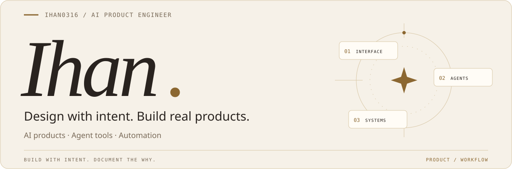
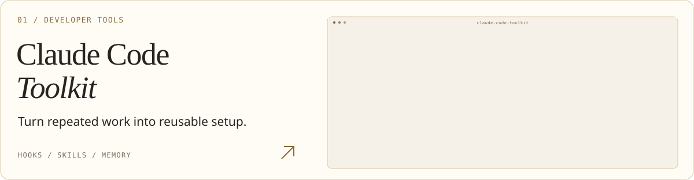
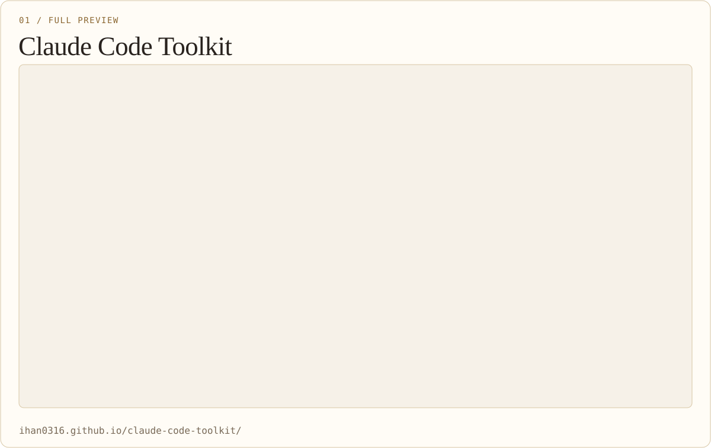
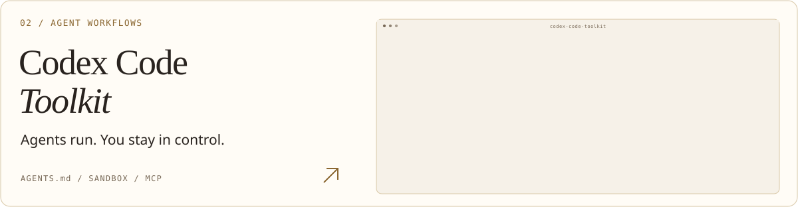
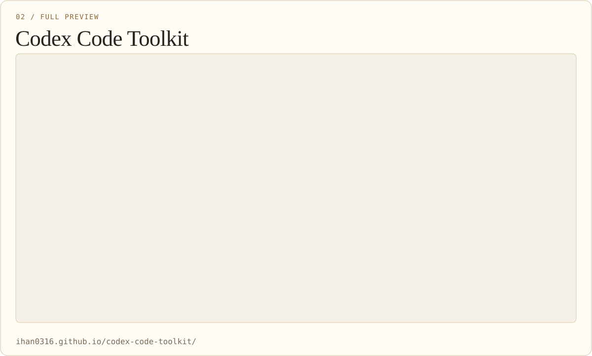
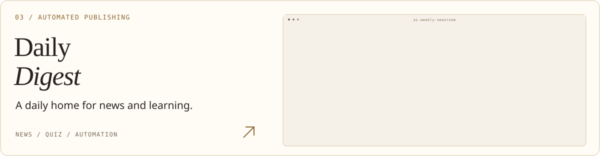
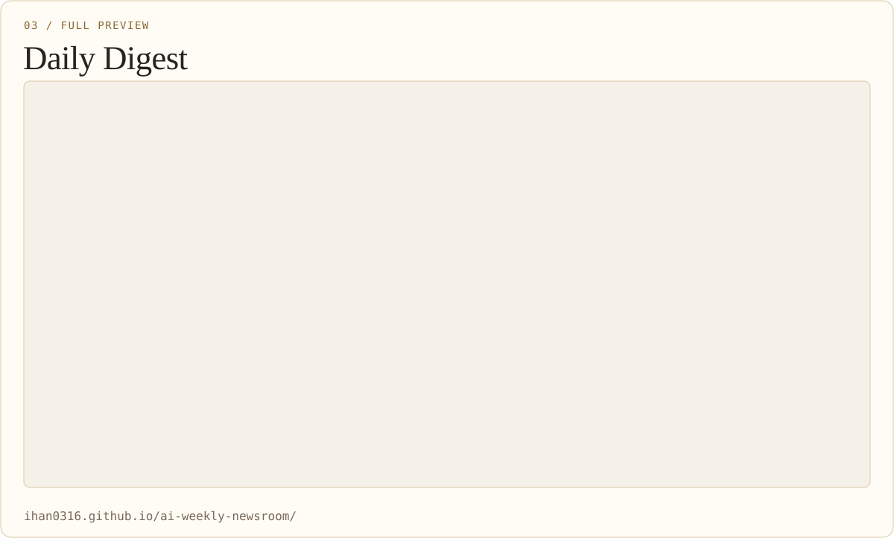
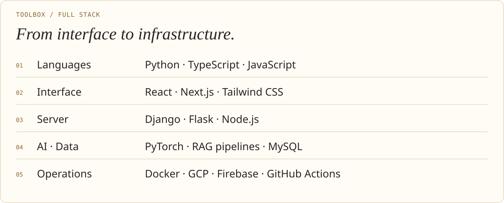
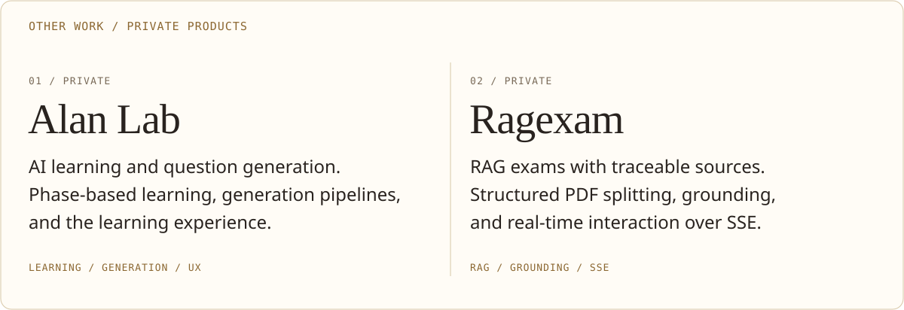

[한국어](./README.md) · **English** · [日本語](./README.ja.md) · [简体中文](./README.zh-CN.md)

<picture>
  <source media="(max-width: 600px) and (prefers-color-scheme: dark)" srcset="./assets/i18n/en/banner-mobile-dark.svg">
  <source media="(max-width: 600px)" srcset="./assets/i18n/en/banner-mobile-light.svg">
  <source media="(prefers-color-scheme: dark)" srcset="./assets/i18n/en/banner-dark.svg">
  
</picture>

**I build AI products and developer tools.** 
Connecting interfaces, generation pipelines, and agent execution rules.

**Email** · `ihann5726@gmail.com` · [Write in Gmail ↗](https://mail.google.com/mail/?view=cm&fs=1&to=ihann5726%40gmail.com)

[Portfolio ↗](https://app.notion.com/p/SW-2df87486686f81489267e22291d6a111?source=copy_link) &nbsp; · &nbsp; [Claude guide ↗](https://ihan0316.github.io/claude-code-toolkit/) &nbsp; · &nbsp; [Codex guide ↗](https://ihan0316.github.io/codex-code-toolkit/)

 

## Selected work

Tools and services I built, with the reasoning behind their design.

<a href="https://ihan0316.github.io/claude-code-toolkit/">
<picture>
  <source media="(max-width: 600px) and (prefers-color-scheme: dark)" srcset="./assets/i18n/en/project-claude-mobile-dark.svg">
  <source media="(max-width: 600px)" srcset="./assets/i18n/en/project-claude-mobile-light.svg">
  <source media="(prefers-color-scheme: dark)" srcset="./assets/i18n/en/project-claude-dark.svg">
  
</picture>
</a>

A practical setup toolkit connecting hooks, skills, memory, automation, and MCP. Korean documentation explains what I configured and why.

[Repository ↗](https://github.com/Ihan0316/claude-code-toolkit) · [Live site ↗](https://ihan0316.github.io/claude-code-toolkit/)

View full screenshots

<picture>
  <source media="(max-width: 600px) and (prefers-color-scheme: dark)" srcset="./assets/i18n/en/detail-screen-claude-mobile-dark.svg">
  <source media="(max-width: 600px)" srcset="./assets/i18n/en/detail-screen-claude-mobile-light.svg">
  <source media="(prefers-color-scheme: dark)" srcset="./assets/i18n/en/detail-screen-claude-dark.svg">
  
</picture>

[Original image ↗](./assets/screenshots/claude-toolkit-preview.png) · [Open site ↗](https://ihan0316.github.io/claude-code-toolkit/)

 

<a href="https://ihan0316.github.io/codex-code-toolkit/">
<picture>
  <source media="(max-width: 600px) and (prefers-color-scheme: dark)" srcset="./assets/i18n/en/project-codex-mobile-dark.svg">
  <source media="(max-width: 600px)" srcset="./assets/i18n/en/project-codex-mobile-light.svg">
  <source media="(prefers-color-scheme: dark)" srcset="./assets/i18n/en/project-codex-dark.svg">
  
</picture>
</a>

A setup guide covering `AGENTS.md`, sandboxing, approval policies, hooks, and MCP. It documents differences between Claude and Codex environments.

[Repository ↗](https://github.com/Ihan0316/codex-code-toolkit) · [Live site ↗](https://ihan0316.github.io/codex-code-toolkit/)

View full screenshots

<picture>
  <source media="(max-width: 600px) and (prefers-color-scheme: dark)" srcset="./assets/i18n/en/detail-screen-codex-mobile-dark.svg">
  <source media="(max-width: 600px)" srcset="./assets/i18n/en/detail-screen-codex-mobile-light.svg">
  <source media="(prefers-color-scheme: dark)" srcset="./assets/i18n/en/detail-screen-codex-dark.svg">
  
</picture>

[Original image ↗](./assets/screenshots/codex-toolkit-preview.png) · [Open site ↗](https://ihan0316.github.io/codex-code-toolkit/)

 

<a href="https://ihan0316.github.io/ai-weekly-newsroom/">
<picture>
  <source media="(max-width: 600px) and (prefers-color-scheme: dark)" srcset="./assets/i18n/en/project-digest-mobile-dark.svg">
  <source media="(max-width: 600px)" srcset="./assets/i18n/en/project-digest-mobile-light.svg">
  <source media="(prefers-color-scheme: dark)" srcset="./assets/i18n/en/project-digest-dark.svg">
  
</picture>
</a>

A static site collecting IT news, information-processing certification quizzes, and developer terms. It connects article search and Q&A with automated collection, builds, and deployment.

[Repository ↗](https://github.com/Ihan0316/ai-weekly-newsroom) · [Live site ↗](https://ihan0316.github.io/ai-weekly-newsroom/)

View full screenshots

<picture>
  <source media="(max-width: 600px) and (prefers-color-scheme: dark)" srcset="./assets/i18n/en/detail-screen-digest-mobile-dark.svg">
  <source media="(max-width: 600px)" srcset="./assets/i18n/en/detail-screen-digest-mobile-light.svg">
  <source media="(prefers-color-scheme: dark)" srcset="./assets/i18n/en/detail-screen-digest-dark.svg">
  
</picture>

[Original image ↗](./assets/screenshots/daily-digest-preview.png) · [Open site ↗](https://ihan0316.github.io/ai-weekly-newsroom/)

 

## Tools and technologies

<picture>
  <source media="(max-width: 600px) and (prefers-color-scheme: dark)" srcset="./assets/i18n/en/stack-mobile-dark.svg">
  <source media="(max-width: 600px)" srcset="./assets/i18n/en/stack-mobile-light.svg">
  <source media="(prefers-color-scheme: dark)" srcset="./assets/i18n/en/stack-dark.svg">
  
</picture>

Full technology stack

<picture>
  <source media="(max-width: 600px) and (prefers-color-scheme: dark)" srcset="./assets/i18n/en/detail-stack-mobile-dark.svg">
  <source media="(max-width: 600px)" srcset="./assets/i18n/en/detail-stack-mobile-light.svg">
  <source media="(prefers-color-scheme: dark)" srcset="./assets/i18n/en/detail-stack-dark.svg">
  
</picture>

Other product work · Private

<picture>
  <source media="(max-width: 600px) and (prefers-color-scheme: dark)" srcset="./assets/i18n/en/detail-private-mobile-dark.svg">
  <source media="(max-width: 600px)" srcset="./assets/i18n/en/detail-private-mobile-light.svg">
  <source media="(prefers-color-scheme: dark)" srcset="./assets/i18n/en/detail-private-dark.svg">
  
</picture>

 

## Contributions and activity

Project history and public contributions are available on GitHub.

[All activity ↗](https://github.com/Ihan0316?tab=overview)

View contribution stats

<a href="https://github.com/Ihan0316?tab=overview">
<picture>
  <source media="(prefers-color-scheme: dark)" srcset="https://streak-stats.demolab.com/?user=Ihan0316&amp;locale=en&amp;timezone=Asia%2FSeoul&amp;background=111316&amp;ring=dfc38c&amp;fire=dfc38c&amp;currStreakLabel=dfc38c&amp;sideLabels=b8ada0&amp;sideNums=f4ede3&amp;currStreakNum=f4ede3&amp;dates=b8ada0&amp;stroke=554b3a&amp;hide_border=true&amp;border_radius=16&amp;disable_animations=true&amp;date_format=Y.n.j">
  <source media="(prefers-color-scheme: light)" srcset="https://streak-stats.demolab.com/?user=Ihan0316&amp;locale=en&amp;timezone=Asia%2FSeoul&amp;background=f6f1e8&amp;ring=8b6731&amp;fire=8b6731&amp;currStreakLabel=8b6731&amp;sideLabels=786957&amp;sideNums=29231f&amp;currStreakNum=29231f&amp;dates=786957&amp;stroke=d8c7a6&amp;hide_border=true&amp;border_radius=16&amp;disable_animations=true&amp;date_format=Y.n.j">
  
</picture>
</a>

[All activity ↗](https://github.com/Ihan0316?tab=overview) · External stats may update late because of caching.

Screenshots retain the original Korean service interface.

---

Build with intent. Document the why. &nbsp; · &nbsp; [Asset credits](./THIRD_PARTY_NOTICES.md)
