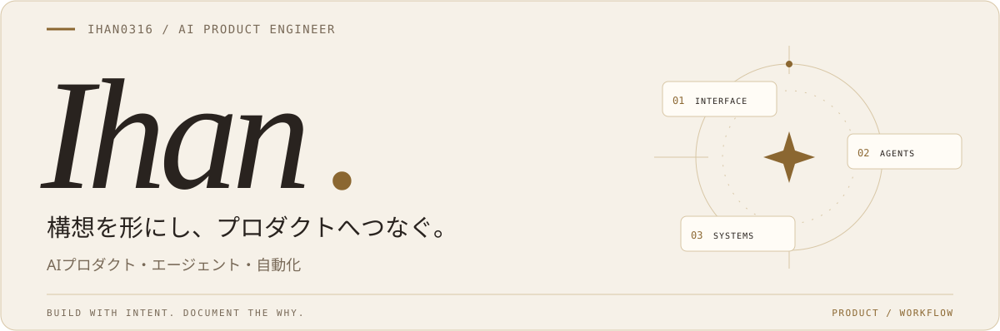
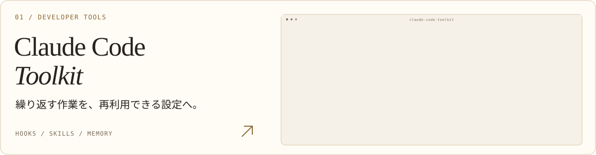
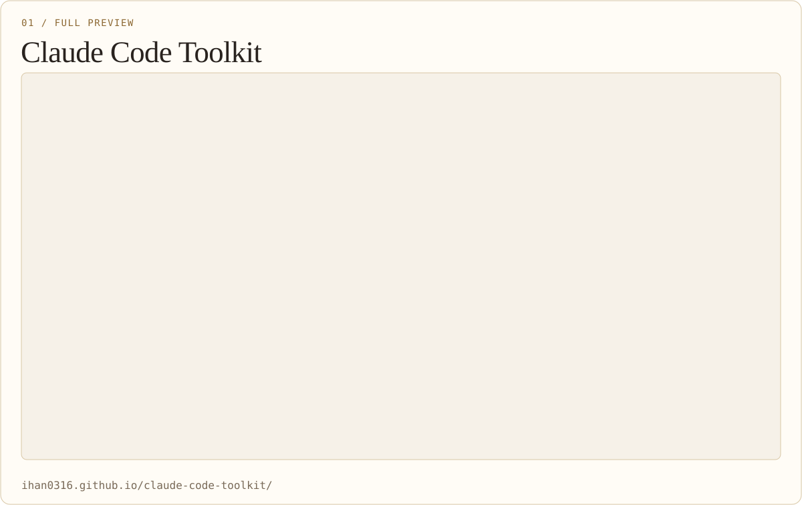
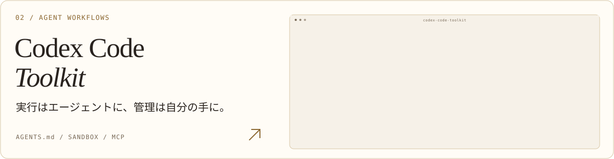
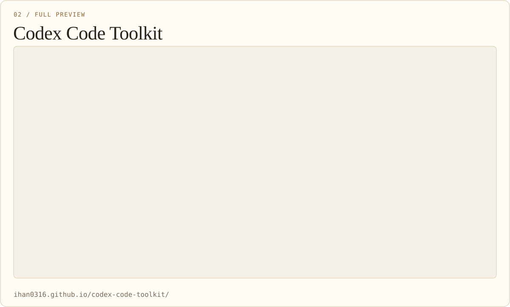
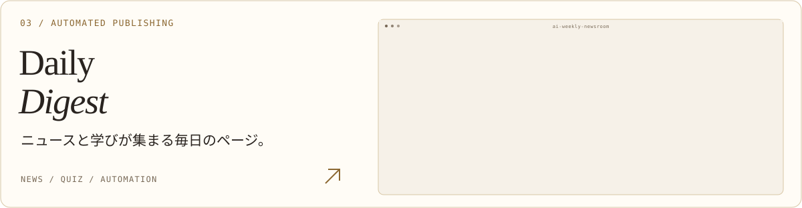
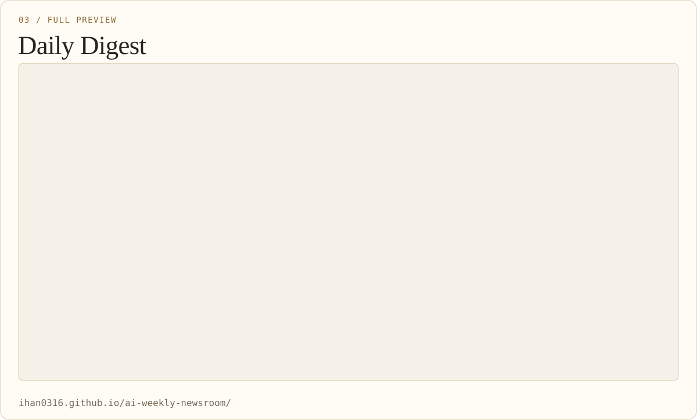
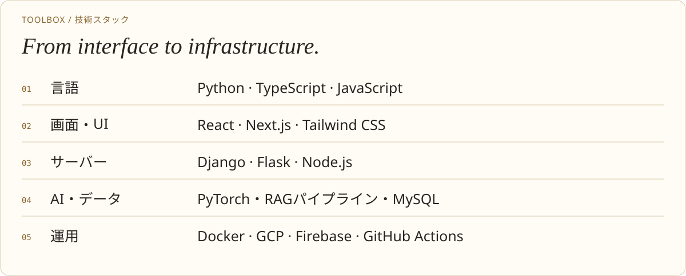
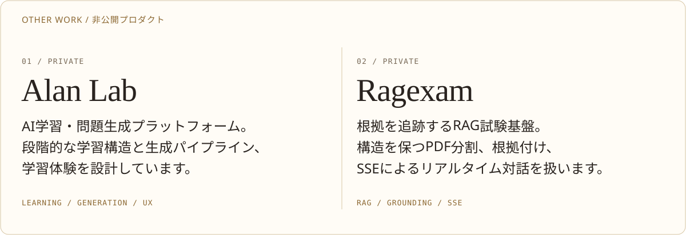

[한국어](./README.md) · [English](./README.en.md) · **日本語** · [简体中文](./README.zh-CN.md)

<picture>
  <source media="(max-width: 600px) and (prefers-color-scheme: dark)" srcset="./assets/i18n/ja/banner-mobile-dark.svg">
  <source media="(max-width: 600px)" srcset="./assets/i18n/ja/banner-mobile-light.svg">
  <source media="(prefers-color-scheme: dark)" srcset="./assets/i18n/ja/banner-dark.svg">
  
</picture>

**AIプロダクトと開発者ツールをつくっています。** 
インターフェースから生成パイプライン、エージェントの実行ルールまで一貫して設計します。

**メール** · `ihann5726@gmail.com` · [Gmailで作成 ↗](https://mail.google.com/mail/?view=cm&fs=1&to=ihann5726%40gmail.com)

[ポートフォリオ ↗](https://app.notion.com/p/SW-2df87486686f81489267e22291d6a111?source=copy_link) &nbsp; · &nbsp; [Claudeガイド ↗](https://ihan0316.github.io/claude-code-toolkit/) &nbsp; · &nbsp; [Codexガイド ↗](https://ihan0316.github.io/codex-code-toolkit/)

 

## 主な制作物

自作のツールやサービスを、設計の理由とともに紹介します。

<a href="https://ihan0316.github.io/claude-code-toolkit/">
<picture>
  <source media="(max-width: 600px) and (prefers-color-scheme: dark)" srcset="./assets/i18n/ja/project-claude-mobile-dark.svg">
  <source media="(max-width: 600px)" srcset="./assets/i18n/ja/project-claude-mobile-light.svg">
  <source media="(prefers-color-scheme: dark)" srcset="./assets/i18n/ja/project-claude-dark.svg">
  
</picture>
</a>

フック・スキル・メモリ・自動化・MCPをつなぐ実践的な設定ツールキット。何を設定し、なぜ必要だったのかを韓国語で記録しています。

[リポジトリ ↗](https://github.com/Ihan0316/claude-code-toolkit) · [サービス画面 ↗](https://ihan0316.github.io/claude-code-toolkit/)

実際の画面を大きく見る

<picture>
  <source media="(max-width: 600px) and (prefers-color-scheme: dark)" srcset="./assets/i18n/ja/detail-screen-claude-mobile-dark.svg">
  <source media="(max-width: 600px)" srcset="./assets/i18n/ja/detail-screen-claude-mobile-light.svg">
  <source media="(prefers-color-scheme: dark)" srcset="./assets/i18n/ja/detail-screen-claude-dark.svg">
  
</picture>

[元画像 ↗](./assets/screenshots/claude-toolkit-preview.png) · [サイトを開く ↗](https://ihan0316.github.io/claude-code-toolkit/)

 

<a href="https://ihan0316.github.io/codex-code-toolkit/">
<picture>
  <source media="(max-width: 600px) and (prefers-color-scheme: dark)" srcset="./assets/i18n/ja/project-codex-mobile-dark.svg">
  <source media="(max-width: 600px)" srcset="./assets/i18n/ja/project-codex-mobile-light.svg">
  <source media="(prefers-color-scheme: dark)" srcset="./assets/i18n/ja/project-codex-dark.svg">
  
</picture>
</a>

`AGENTS.md`・サンドボックス・承認ポリシー・フック・MCPを扱う設定ガイド。ClaudeとCodexの環境の違いを文書化しています。

[リポジトリ ↗](https://github.com/Ihan0316/codex-code-toolkit) · [サービス画面 ↗](https://ihan0316.github.io/codex-code-toolkit/)

実際の画面を大きく見る

<picture>
  <source media="(max-width: 600px) and (prefers-color-scheme: dark)" srcset="./assets/i18n/ja/detail-screen-codex-mobile-dark.svg">
  <source media="(max-width: 600px)" srcset="./assets/i18n/ja/detail-screen-codex-mobile-light.svg">
  <source media="(prefers-color-scheme: dark)" srcset="./assets/i18n/ja/detail-screen-codex-dark.svg">
  
</picture>

[元画像 ↗](./assets/screenshots/codex-toolkit-preview.png) · [サイトを開く ↗](https://ihan0316.github.io/codex-code-toolkit/)

 

<a href="https://ihan0316.github.io/ai-weekly-newsroom/">
<picture>
  <source media="(max-width: 600px) and (prefers-color-scheme: dark)" srcset="./assets/i18n/ja/project-digest-mobile-dark.svg">
  <source media="(max-width: 600px)" srcset="./assets/i18n/ja/project-digest-mobile-light.svg">
  <source media="(prefers-color-scheme: dark)" srcset="./assets/i18n/ja/project-digest-dark.svg">
  
</picture>
</a>

ITニュース・情報処理技士試験のクイズ・開発用語をまとめた静的サイト。記事検索・Q&Aと、収集・ビルド・公開の自動化をつないでいます。

[リポジトリ ↗](https://github.com/Ihan0316/ai-weekly-newsroom) · [サービス画面 ↗](https://ihan0316.github.io/ai-weekly-newsroom/)

実際の画面を大きく見る

<picture>
  <source media="(max-width: 600px) and (prefers-color-scheme: dark)" srcset="./assets/i18n/ja/detail-screen-digest-mobile-dark.svg">
  <source media="(max-width: 600px)" srcset="./assets/i18n/ja/detail-screen-digest-mobile-light.svg">
  <source media="(prefers-color-scheme: dark)" srcset="./assets/i18n/ja/detail-screen-digest-dark.svg">
  
</picture>

[元画像 ↗](./assets/screenshots/daily-digest-preview.png) · [サイトを開く ↗](https://ihan0316.github.io/ai-weekly-newsroom/)

 

## ツールと技術

<picture>
  <source media="(max-width: 600px) and (prefers-color-scheme: dark)" srcset="./assets/i18n/ja/stack-mobile-dark.svg">
  <source media="(max-width: 600px)" srcset="./assets/i18n/ja/stack-mobile-light.svg">
  <source media="(prefers-color-scheme: dark)" srcset="./assets/i18n/ja/stack-dark.svg">
  
</picture>

技術スタックの一覧

<picture>
  <source media="(max-width: 600px) and (prefers-color-scheme: dark)" srcset="./assets/i18n/ja/detail-stack-mobile-dark.svg">
  <source media="(max-width: 600px)" srcset="./assets/i18n/ja/detail-stack-mobile-light.svg">
  <source media="(prefers-color-scheme: dark)" srcset="./assets/i18n/ja/detail-stack-dark.svg">
  
</picture>

そのほかの制作物・非公開

<picture>
  <source media="(max-width: 600px) and (prefers-color-scheme: dark)" srcset="./assets/i18n/ja/detail-private-mobile-dark.svg">
  <source media="(max-width: 600px)" srcset="./assets/i18n/ja/detail-private-mobile-light.svg">
  <source media="(prefers-color-scheme: dark)" srcset="./assets/i18n/ja/detail-private-dark.svg">
  
</picture>

 

## コントリビューションと記録

プロジェクトの変更履歴と公開コントリビューションはGitHubで確認できます。

[すべての活動 ↗](https://github.com/Ihan0316?tab=overview)

コントリビューション統計を表示

<a href="https://github.com/Ihan0316?tab=overview">
<picture>
  <source media="(prefers-color-scheme: dark)" srcset="https://streak-stats.demolab.com/?user=Ihan0316&amp;locale=ja&amp;timezone=Asia%2FSeoul&amp;background=111316&amp;ring=dfc38c&amp;fire=dfc38c&amp;currStreakLabel=dfc38c&amp;sideLabels=b8ada0&amp;sideNums=f4ede3&amp;currStreakNum=f4ede3&amp;dates=b8ada0&amp;stroke=554b3a&amp;hide_border=true&amp;border_radius=16&amp;disable_animations=true&amp;date_format=Y.n.j">
  <source media="(prefers-color-scheme: light)" srcset="https://streak-stats.demolab.com/?user=Ihan0316&amp;locale=ja&amp;timezone=Asia%2FSeoul&amp;background=f6f1e8&amp;ring=8b6731&amp;fire=8b6731&amp;currStreakLabel=8b6731&amp;sideLabels=786957&amp;sideNums=29231f&amp;currStreakNum=29231f&amp;dates=786957&amp;stroke=d8c7a6&amp;hide_border=true&amp;border_radius=16&amp;disable_animations=true&amp;date_format=Y.n.j">
  
</picture>
</a>

[すべての活動 ↗](https://github.com/Ihan0316?tab=overview) · 外部統計はキャッシュにより更新が遅れる場合があります。

スクリーンショットは元の韓国語のサービス画面です。

---

Build with intent. Document the why. &nbsp; · &nbsp; [素材の出典](./THIRD_PARTY_NOTICES.md)
