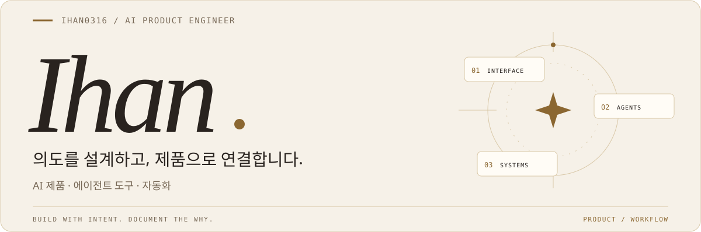

<picture>
  <source media="(prefers-color-scheme: dark)" srcset="./assets/banner-dark.svg">
  <source media="(prefers-color-scheme: light)" srcset="./assets/banner-light.svg">
  
</picture>

 

**AI를 기능에서 워크플로로 연결합니다.**

문제를 한 번 푸는 것보다, 같은 문제가 반복되지 않는 구조에 관심이 있습니다.
AI 제품의 인터페이스부터 생성 파이프라인, 에이전트의 실행 규칙까지 만듭니다.

[이메일](mailto:ihann5726@gmail.com) &nbsp; / &nbsp; [포트폴리오](https://app.notion.com/p/SW-2df87486686f81489267e22291d6a111?source=copy_link) &nbsp; / &nbsp; [Claude 가이드](https://ihan0316.github.io/claude-code-toolkit/) &nbsp; / &nbsp; [Codex 가이드](https://ihan0316.github.io/codex-code-toolkit/)

 

## 직접 만들고, 기록하는 것

### 01 &nbsp; [Claude Code Toolkit](https://github.com/Ihan0316/claude-code-toolkit)

**매번 설명하던 작업 방식을, 다시 쓸 수 있는 설정으로.**

훅 · 스킬 · 메모리 · 자동화 · MCP를 정리한 실전 셋업 툴킷.
무엇을 설정했는지와 함께, 왜 필요했고 무엇이 달라졌는지 한국어 문서로 남깁니다.

[저장소 ↗](https://github.com/Ihan0316/claude-code-toolkit) · [문서 사이트 ↗](https://ihan0316.github.io/claude-code-toolkit/)

---

### 02 &nbsp; [Codex Code Toolkit](https://github.com/Ihan0316/codex-code-toolkit)

**작업은 에이전트에게, 실행 범위는 내 통제 아래.**

`AGENTS.md` · 샌드박스 · 승인 정책 · 훅 · MCP를 다루는 Codex 셋업 가이드.
Claude와 Codex의 실행 방식에 맞춰 규칙을 옮기고, 환경 차이를 문서화합니다.

[저장소 ↗](https://github.com/Ihan0316/codex-code-toolkit) · [문서 사이트 ↗](https://ihan0316.github.io/codex-code-toolkit/)

---

### 03 &nbsp; [Daily Digest](https://github.com/Ihan0316/ai-weekly-newsroom)

**뉴스를 읽고, 질문하고, 짧게 배우는 매일의 페이지.**

IT 뉴스 · 정보처리기사 퀴즈 · 개발 용어를 모으는 정적 사이트.
기사 검색과 Q&A를 연결하고, 수집부터 빌드·배포까지 GitHub Actions로 구성했습니다.

[저장소 ↗](https://github.com/Ihan0316/ai-weekly-newsroom) · [서비스 ↗](https://ihan0316.github.io/ai-weekly-newsroom/)

 

## 주로 사용하는 도구

| 영역 | 도구 |
| :--- | :--- |
| 언어 | Python · TypeScript · JavaScript |
| 인터페이스 | React · Next.js · Tailwind CSS |
| 서버 | Django · Flask · Node.js |
| AI · 데이터 | PyTorch · RAG 파이프라인 · MySQL |
| 운영 | Docker · GCP · Firebase · GitHub Actions |

 

<b>그 밖의 제품 작업</b> · 비공개

 

**Alan Lab** — AI 학습·문제 생성 플랫폼. 페이즈 기반 학습 구조, 생성 파이프라인과 학습 UX를 설계합니다.

**Ragexam** — 근거를 추적하는 RAG 시험 플랫폼. 구조적 PDF 분할, grounding, SSE 기반 실시간 상호작용을 다룹니다.

<b>기여 기록</b>

 

<picture>
  <source media="(prefers-color-scheme: dark)" srcset="https://raw.githubusercontent.com/Ihan0316/Ihan0316/output/github-snake-dark.svg">
  <source media="(prefers-color-scheme: light)" srcset="https://raw.githubusercontent.com/Ihan0316/Ihan0316/output/github-snake.svg">
  
</picture>

