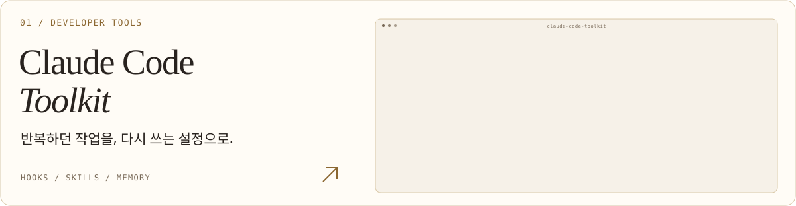
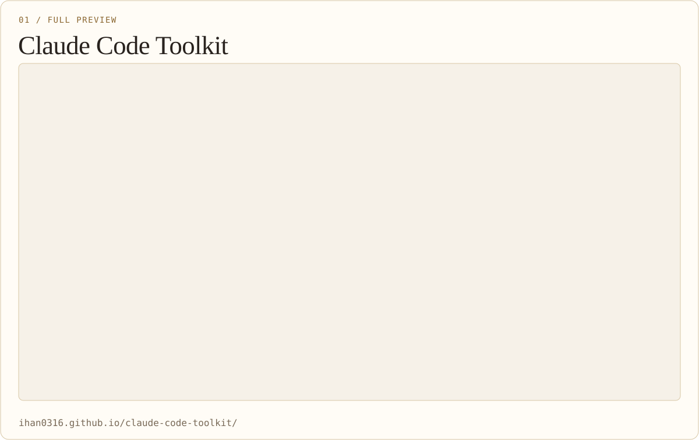
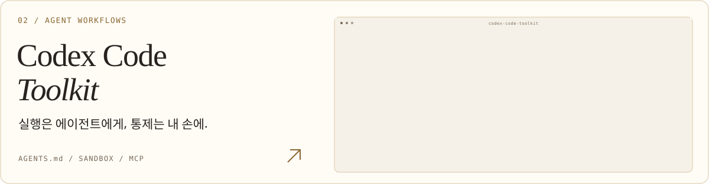
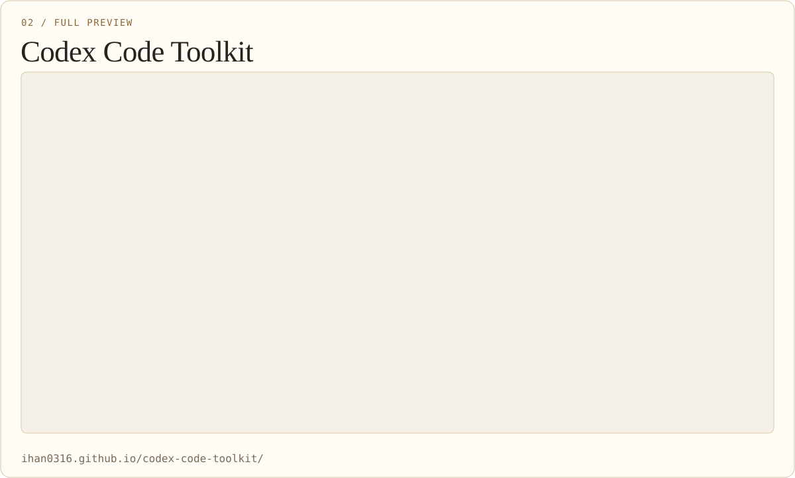
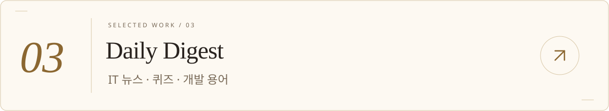
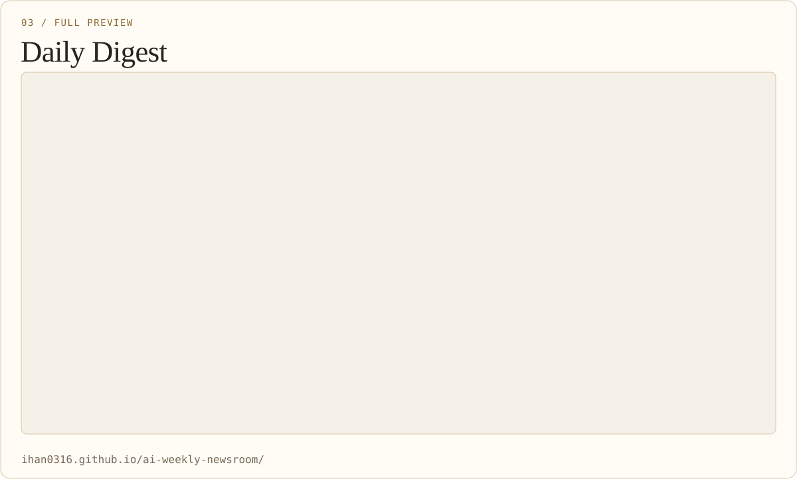
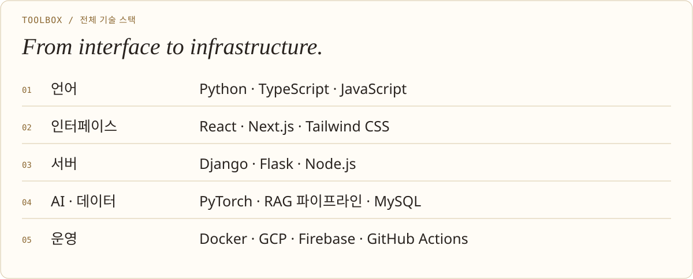
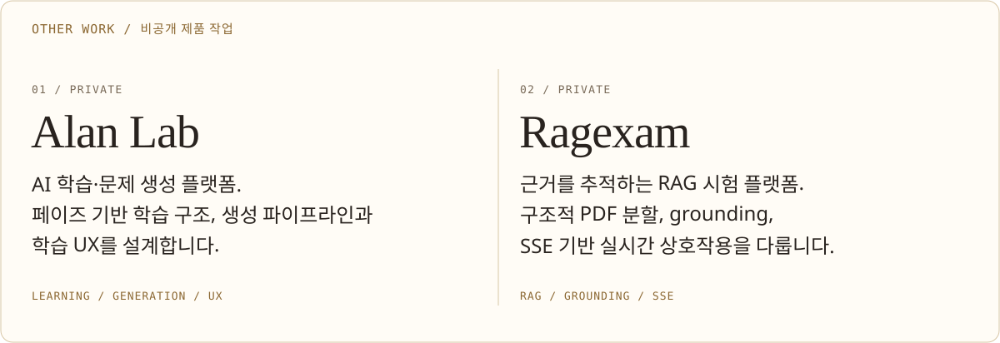
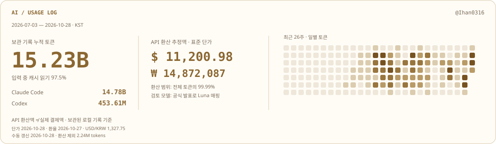

**한국어** · [English](./README.en.md) · [日本語](./README.ja.md) · [简体中文](./README.zh-CN.md)

<picture>
  <source media="(max-width: 600px) and (prefers-color-scheme: dark)" srcset="./assets/banner-mobile-dark.svg">
  <source media="(max-width: 600px)" srcset="./assets/banner-mobile-light.svg">
  <source media="(prefers-color-scheme: dark)" srcset="./assets/banner-dark.svg">
  
</picture>

**AI 제품과 개발자 도구를 만듭니다.** 
인터페이스부터 생성 파이프라인, 에이전트의 실행 규칙까지 연결합니다.

**메일** · `ihann5726@gmail.com` · [Gmail로 쓰기 ↗](https://mail.google.com/mail/?view=cm&fs=1&to=ihann5726%40gmail.com)

[포트폴리오 ↗](https://app.notion.com/p/SW-2df87486686f81489267e22291d6a111?source=copy_link) &nbsp; · &nbsp; [Claude 가이드 ↗](https://ihan0316.github.io/claude-code-toolkit/) &nbsp; · &nbsp; [Codex 가이드 ↗](https://ihan0316.github.io/codex-code-toolkit/)

 

## 대표 작업

직접 만든 도구와 서비스를, 설계 이유와 함께 기록합니다.

<a href="https://ihan0316.github.io/claude-code-toolkit/">
<picture>
  <source media="(max-width: 600px) and (prefers-color-scheme: dark)" srcset="./assets/project-claude-mobile-dark.svg">
  <source media="(max-width: 600px)" srcset="./assets/project-claude-mobile-light.svg">
  <source media="(prefers-color-scheme: dark)" srcset="./assets/project-claude-dark.svg">
  
</picture>
</a>

훅·스킬·메모리·자동화·MCP를 연결한 실전 셋업 툴킷. 무엇을 설정했고 왜 필요했는지 한국어 문서로 남깁니다.

[저장소 ↗](https://github.com/Ihan0316/claude-code-toolkit) · [서비스 화면 ↗](https://ihan0316.github.io/claude-code-toolkit/)

실제 화면 크게 보기

<picture>
  <source media="(max-width: 600px) and (prefers-color-scheme: dark)" srcset="./assets/detail-screen-claude-mobile-dark.svg">
  <source media="(max-width: 600px)" srcset="./assets/detail-screen-claude-mobile-light.svg">
  <source media="(prefers-color-scheme: dark)" srcset="./assets/detail-screen-claude-dark.svg">
  
</picture>

[원본 이미지 ↗](./assets/screenshots/claude-toolkit-preview.png) · [서비스 열기 ↗](https://ihan0316.github.io/claude-code-toolkit/)

 

<a href="https://ihan0316.github.io/codex-code-toolkit/">
<picture>
  <source media="(max-width: 600px) and (prefers-color-scheme: dark)" srcset="./assets/project-codex-mobile-dark.svg">
  <source media="(max-width: 600px)" srcset="./assets/project-codex-mobile-light.svg">
  <source media="(prefers-color-scheme: dark)" srcset="./assets/project-codex-dark.svg">
  
</picture>
</a>

`AGENTS.md`·샌드박스·승인 정책·훅·MCP를 다루는 셋업 가이드. Claude와 Codex의 환경 차이를 문서화합니다.

[저장소 ↗](https://github.com/Ihan0316/codex-code-toolkit) · [서비스 화면 ↗](https://ihan0316.github.io/codex-code-toolkit/)

실제 화면 크게 보기

<picture>
  <source media="(max-width: 600px) and (prefers-color-scheme: dark)" srcset="./assets/detail-screen-codex-mobile-dark.svg">
  <source media="(max-width: 600px)" srcset="./assets/detail-screen-codex-mobile-light.svg">
  <source media="(prefers-color-scheme: dark)" srcset="./assets/detail-screen-codex-dark.svg">
  
</picture>

[원본 이미지 ↗](./assets/screenshots/codex-toolkit-preview.png) · [서비스 열기 ↗](https://ihan0316.github.io/codex-code-toolkit/)

 

<a href="https://ihan0316.github.io/ai-weekly-newsroom/">
<picture>
  <source media="(max-width: 600px) and (prefers-color-scheme: dark)" srcset="./assets/project-digest-mobile-dark.svg">
  <source media="(max-width: 600px)" srcset="./assets/project-digest-mobile-light.svg">
  <source media="(prefers-color-scheme: dark)" srcset="./assets/project-digest-dark.svg">
  
</picture>
</a>

IT 뉴스·정보처리기사 퀴즈·개발 용어를 모으는 정적 사이트. 기사 검색·Q&A와 수집·빌드·배포 자동화를 연결합니다.

[저장소 ↗](https://github.com/Ihan0316/ai-weekly-newsroom) · [서비스 화면 ↗](https://ihan0316.github.io/ai-weekly-newsroom/)

실제 화면 크게 보기

<picture>
  <source media="(max-width: 600px) and (prefers-color-scheme: dark)" srcset="./assets/detail-screen-digest-mobile-dark.svg">
  <source media="(max-width: 600px)" srcset="./assets/detail-screen-digest-mobile-light.svg">
  <source media="(prefers-color-scheme: dark)" srcset="./assets/detail-screen-digest-dark.svg">
  
</picture>

[원본 이미지 ↗](./assets/screenshots/daily-digest-preview.png) · [서비스 열기 ↗](https://ihan0316.github.io/ai-weekly-newsroom/)

 

## 도구와 기술

<picture>
  <source media="(max-width: 600px) and (prefers-color-scheme: dark)" srcset="./assets/stack-mobile-dark.svg">
  <source media="(max-width: 600px)" srcset="./assets/stack-mobile-light.svg">
  <source media="(prefers-color-scheme: dark)" srcset="./assets/stack-dark.svg">
  
</picture>

전체 기술 스택

<picture>
  <source media="(max-width: 600px) and (prefers-color-scheme: dark)" srcset="./assets/detail-stack-mobile-dark.svg">
  <source media="(max-width: 600px)" srcset="./assets/detail-stack-mobile-light.svg">
  <source media="(prefers-color-scheme: dark)" srcset="./assets/detail-stack-dark.svg">
  
</picture>

그 밖의 제품 작업 · 비공개

<picture>
  <source media="(max-width: 600px) and (prefers-color-scheme: dark)" srcset="./assets/detail-private-mobile-dark.svg">
  <source media="(max-width: 600px)" srcset="./assets/detail-private-mobile-light.svg">
  <source media="(prefers-color-scheme: dark)" srcset="./assets/detail-private-dark.svg">
  
</picture>

 

## AI 사용 기록

<picture>
  <source media="(max-width: 600px) and (prefers-color-scheme: dark)" srcset="./assets/ai-usage-mobile-dark.svg">
  <source media="(max-width: 600px)" srcset="./assets/ai-usage-mobile-light.svg">
  <source media="(prefers-color-scheme: dark)" srcset="./assets/ai-usage-dark.svg">
  
</picture>

보관된 로컬 로그 기준 · 수동 갱신 스냅샷 · [집계 기준](./data/AI_USAGE.md)

 

## 기여와 기록

프로젝트의 변경 이력과 공개 기여 기록을 GitHub에서 확인할 수 있습니다.

[전체 활동 ↗](https://github.com/Ihan0316?tab=overview)

기여 통계 펼치기

<a href="https://github.com/Ihan0316?tab=overview">
<picture>
  <source media="(prefers-color-scheme: dark)" srcset="https://streak-stats.demolab.com/?user=Ihan0316&amp;locale=ko&amp;timezone=Asia%2FSeoul&amp;background=111316&amp;ring=dfc38c&amp;fire=dfc38c&amp;currStreakLabel=dfc38c&amp;sideLabels=b8ada0&amp;sideNums=f4ede3&amp;currStreakNum=f4ede3&amp;dates=b8ada0&amp;stroke=554b3a&amp;hide_border=true&amp;border_radius=16&amp;disable_animations=true&amp;date_format=Y.n.j">
  <source media="(prefers-color-scheme: light)" srcset="https://streak-stats.demolab.com/?user=Ihan0316&amp;locale=ko&amp;timezone=Asia%2FSeoul&amp;background=f6f1e8&amp;ring=8b6731&amp;fire=8b6731&amp;currStreakLabel=8b6731&amp;sideLabels=786957&amp;sideNums=29231f&amp;currStreakNum=29231f&amp;dates=786957&amp;stroke=d8c7a6&amp;hide_border=true&amp;border_radius=16&amp;disable_animations=true&amp;date_format=Y.n.j">
  
</picture>
</a>

[전체 활동 ↗](https://github.com/Ihan0316?tab=overview) · 외부 통계는 캐시로 갱신이 늦을 수 있습니다.

---

Build with intent. Document the why. &nbsp; · &nbsp; [에셋 출처](./THIRD_PARTY_NOTICES.md)

