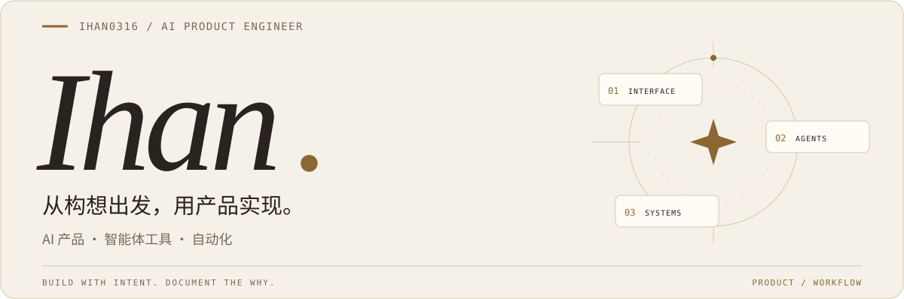
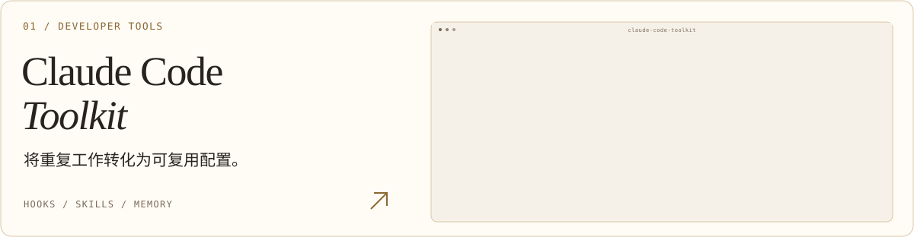
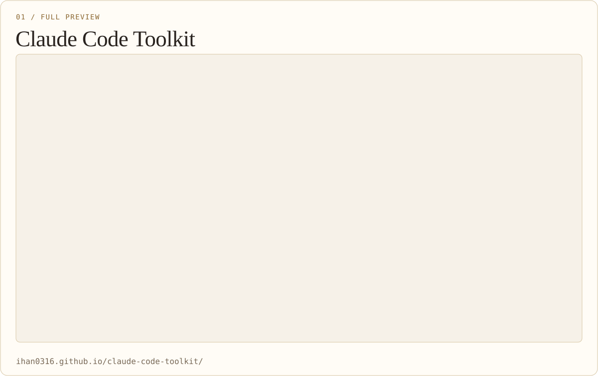
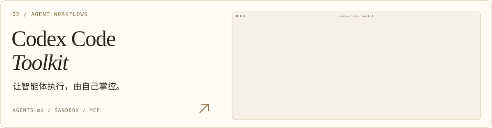
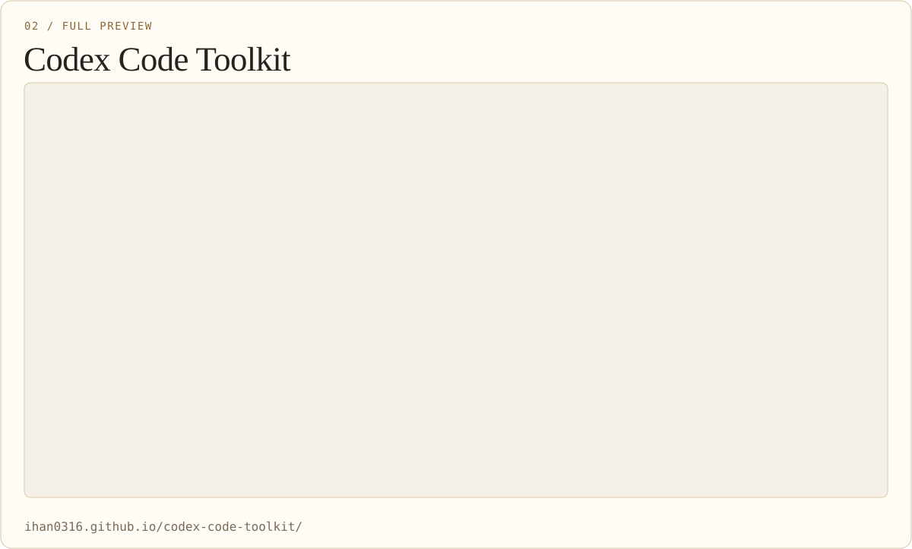
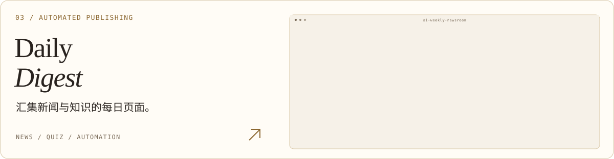
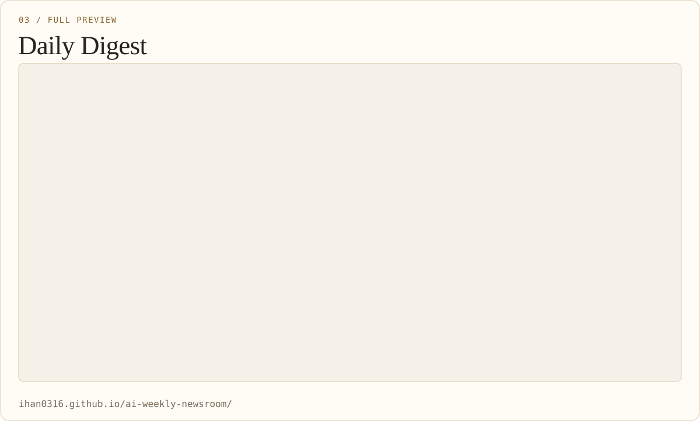
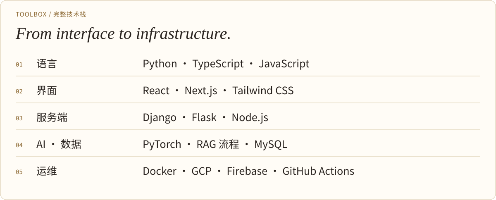
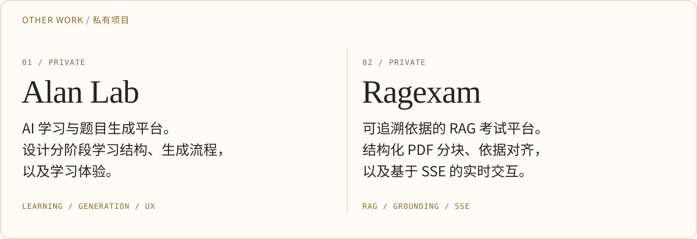

[한국어](./README.md) · [English](./README.en.md) · [日本語](./README.ja.md) · **简体中文**

<picture>
  <source media="(max-width: 600px) and (prefers-color-scheme: dark)" srcset="./assets/i18n/zh-CN/banner-mobile-dark.svg">
  <source media="(max-width: 600px)" srcset="./assets/i18n/zh-CN/banner-mobile-light.svg">
  <source media="(prefers-color-scheme: dark)" srcset="./assets/i18n/zh-CN/banner-dark.svg">
  
</picture>

**我构建 AI 产品与开发者工具。** 
串联交互界面、生成流程与智能体执行规则。

**邮箱** · `ihann5726@gmail.com` · [用 Gmail 撰写 ↗](https://mail.google.com/mail/?view=cm&fs=1&to=ihann5726%40gmail.com)

[作品集 ↗](https://app.notion.com/p/SW-2df87486686f81489267e22291d6a111?source=copy_link) &nbsp; · &nbsp; [Claude 指南 ↗](https://ihan0316.github.io/claude-code-toolkit/) &nbsp; · &nbsp; [Codex 指南 ↗](https://ihan0316.github.io/codex-code-toolkit/)

 

## 代表项目

展示我构建的工具与服务，并记录背后的设计思路。

<a href="https://ihan0316.github.io/claude-code-toolkit/">
<picture>
  <source media="(max-width: 600px) and (prefers-color-scheme: dark)" srcset="./assets/i18n/zh-CN/project-claude-mobile-dark.svg">
  <source media="(max-width: 600px)" srcset="./assets/i18n/zh-CN/project-claude-mobile-light.svg">
  <source media="(prefers-color-scheme: dark)" srcset="./assets/i18n/zh-CN/project-claude-dark.svg">
  
</picture>
</a>

串联钩子、技能、记忆、自动化与 MCP 的实用配置工具包。以韩语文档记录配置内容及其必要性。

[代码仓库 ↗](https://github.com/Ihan0316/claude-code-toolkit) · [服务页面 ↗](https://ihan0316.github.io/claude-code-toolkit/)

查看完整截图

<picture>
  <source media="(max-width: 600px) and (prefers-color-scheme: dark)" srcset="./assets/i18n/zh-CN/detail-screen-claude-mobile-dark.svg">
  <source media="(max-width: 600px)" srcset="./assets/i18n/zh-CN/detail-screen-claude-mobile-light.svg">
  <source media="(prefers-color-scheme: dark)" srcset="./assets/i18n/zh-CN/detail-screen-claude-dark.svg">
  
</picture>

[原图 ↗](./assets/screenshots/claude-toolkit-preview.png) · [打开网站 ↗](https://ihan0316.github.io/claude-code-toolkit/)

 

<a href="https://ihan0316.github.io/codex-code-toolkit/">
<picture>
  <source media="(max-width: 600px) and (prefers-color-scheme: dark)" srcset="./assets/i18n/zh-CN/project-codex-mobile-dark.svg">
  <source media="(max-width: 600px)" srcset="./assets/i18n/zh-CN/project-codex-mobile-light.svg">
  <source media="(prefers-color-scheme: dark)" srcset="./assets/i18n/zh-CN/project-codex-dark.svg">
  
</picture>
</a>

涵盖 `AGENTS.md`、沙箱、审批策略、钩子与 MCP 的配置指南，并记录 Claude 与 Codex 环境的差异。

[代码仓库 ↗](https://github.com/Ihan0316/codex-code-toolkit) · [服务页面 ↗](https://ihan0316.github.io/codex-code-toolkit/)

查看完整截图

<picture>
  <source media="(max-width: 600px) and (prefers-color-scheme: dark)" srcset="./assets/i18n/zh-CN/detail-screen-codex-mobile-dark.svg">
  <source media="(max-width: 600px)" srcset="./assets/i18n/zh-CN/detail-screen-codex-mobile-light.svg">
  <source media="(prefers-color-scheme: dark)" srcset="./assets/i18n/zh-CN/detail-screen-codex-dark.svg">
  
</picture>

[原图 ↗](./assets/screenshots/codex-toolkit-preview.png) · [打开网站 ↗](https://ihan0316.github.io/codex-code-toolkit/)

 

<a href="https://ihan0316.github.io/ai-weekly-newsroom/">
<picture>
  <source media="(max-width: 600px) and (prefers-color-scheme: dark)" srcset="./assets/i18n/zh-CN/project-digest-mobile-dark.svg">
  <source media="(max-width: 600px)" srcset="./assets/i18n/zh-CN/project-digest-mobile-light.svg">
  <source media="(prefers-color-scheme: dark)" srcset="./assets/i18n/zh-CN/project-digest-dark.svg">
  
</picture>
</a>

汇集 IT 新闻、信息处理工程师考试测验与开发术语的静态网站，结合文章搜索、问答以及采集、构建和发布自动化。

[代码仓库 ↗](https://github.com/Ihan0316/ai-weekly-newsroom) · [服务页面 ↗](https://ihan0316.github.io/ai-weekly-newsroom/)

查看完整截图

<picture>
  <source media="(max-width: 600px) and (prefers-color-scheme: dark)" srcset="./assets/i18n/zh-CN/detail-screen-digest-mobile-dark.svg">
  <source media="(max-width: 600px)" srcset="./assets/i18n/zh-CN/detail-screen-digest-mobile-light.svg">
  <source media="(prefers-color-scheme: dark)" srcset="./assets/i18n/zh-CN/detail-screen-digest-dark.svg">
  
</picture>

[原图 ↗](./assets/screenshots/daily-digest-preview.png) · [打开网站 ↗](https://ihan0316.github.io/ai-weekly-newsroom/)

 

## 工具与技术

<picture>
  <source media="(max-width: 600px) and (prefers-color-scheme: dark)" srcset="./assets/i18n/zh-CN/stack-mobile-dark.svg">
  <source media="(max-width: 600px)" srcset="./assets/i18n/zh-CN/stack-mobile-light.svg">
  <source media="(prefers-color-scheme: dark)" srcset="./assets/i18n/zh-CN/stack-dark.svg">
  
</picture>

完整技术栈

<picture>
  <source media="(max-width: 600px) and (prefers-color-scheme: dark)" srcset="./assets/i18n/zh-CN/detail-stack-mobile-dark.svg">
  <source media="(max-width: 600px)" srcset="./assets/i18n/zh-CN/detail-stack-mobile-light.svg">
  <source media="(prefers-color-scheme: dark)" srcset="./assets/i18n/zh-CN/detail-stack-dark.svg">
  
</picture>

其他产品项目 · 私有

<picture>
  <source media="(max-width: 600px) and (prefers-color-scheme: dark)" srcset="./assets/i18n/zh-CN/detail-private-mobile-dark.svg">
  <source media="(max-width: 600px)" srcset="./assets/i18n/zh-CN/detail-private-mobile-light.svg">
  <source media="(prefers-color-scheme: dark)" srcset="./assets/i18n/zh-CN/detail-private-dark.svg">
  
</picture>

 

## 贡献与记录

可在 GitHub 查看项目变更历史与公开贡献。

[全部活动 ↗](https://github.com/Ihan0316?tab=overview)

展开贡献统计

<a href="https://github.com/Ihan0316?tab=overview">
<picture>
  <source media="(prefers-color-scheme: dark)" srcset="https://streak-stats.demolab.com/?user=Ihan0316&amp;locale=zh_Hans&amp;timezone=Asia%2FSeoul&amp;background=111316&amp;ring=dfc38c&amp;fire=dfc38c&amp;currStreakLabel=dfc38c&amp;sideLabels=b8ada0&amp;sideNums=f4ede3&amp;currStreakNum=f4ede3&amp;dates=b8ada0&amp;stroke=554b3a&amp;hide_border=true&amp;border_radius=16&amp;disable_animations=true&amp;date_format=Y.n.j">
  <source media="(prefers-color-scheme: light)" srcset="https://streak-stats.demolab.com/?user=Ihan0316&amp;locale=zh_Hans&amp;timezone=Asia%2FSeoul&amp;background=f6f1e8&amp;ring=8b6731&amp;fire=8b6731&amp;currStreakLabel=8b6731&amp;sideLabels=786957&amp;sideNums=29231f&amp;currStreakNum=29231f&amp;dates=786957&amp;stroke=d8c7a6&amp;hide_border=true&amp;border_radius=16&amp;disable_animations=true&amp;date_format=Y.n.j">
  
</picture>
</a>

[全部活动 ↗](https://github.com/Ihan0316?tab=overview) · 外部统计可能因缓存而延迟更新。

截图保留原有的韩语服务界面。

---

Build with intent. Document the why. &nbsp; · &nbsp; [素材来源](./THIRD_PARTY_NOTICES.md)
